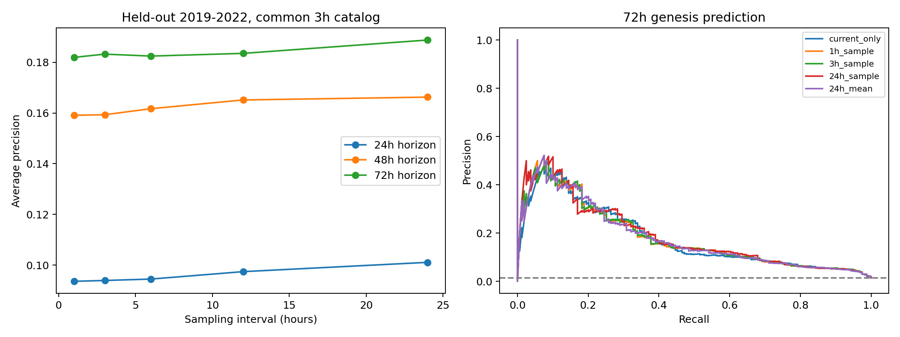

# 选题 A：时间分辨率与热带气旋形成判识

分析日期：2026-10-28。这是基于现有 5°块平均数据的回顾性基准实验，不是已验证的业务预报，也不保证可直接发表。主实验计划在运行前保存于 analysis_plan.json，未进行外部预注册。

## 核心结论

在同一个因果生成的三小时候选目录、相同测试样本和固定维度逻辑回归下，没有证据表明小时历史显著优于日尺度历史。72h AP：1h 抽样约 0.1819、24h 抽样约 0.1888、24h 均值约 0.1818。两项预定成对差值区间均包含 0。

这不证明小时数据普遍无用。结论限于当前 5°空间分辨率、候选识别/关联规则、特征摘要和简单模型。复杂结构被摘要成八个历史量，高频信息可能没有被充分利用。

## 数据与时间检查

输入为 2000—2022 年 NA 小时、三小时涡度，NA 日均涡度及 IBTrACS NA 主路径。三小时 67208×160，小时 201624×160。全时段逐点核实：小时每三小时抽样与三小时产品最大差为 0.00e+00；小时聚合日均与原日均在有效位置的平均/最大绝对差为 2.41e-13/8.49e-12。

原日均六个闰日整行缺失，但小时源的这些日期存在有限值。实验中的日尺度历史由小时源构造，因而保持完整公历；没有改写原日数据。时间暂按 UTC 解释，涡度单位及原始生产流程仍待来源确认。

## 候选识别、标签和对照

每个三小时场独立找 3×3 邻域正涡度极大值，阈值为文件数值 1e-5；其量级由训练期分布检查支持，并非本轮已确认的物理形成阈值。通过距上一时刻不超过 800km 的一对一最优匹配加幅度惩罚连续赋 ID；不使用未来位置、不桥接漏检。800km 是适应粗格点跳动的关联门限，不是物理移动速度判断。

目录共 765913 次峰值观测、81539 条轨迹。其中很多只是粗网格背景涡度峰，不能把它们都当作独立确认的真实热带扰动。

每条完整 IBTrACS 主路径首次 TD/TS/HU 作为首次热带分类，先找全记录中的首次时刻，再限制 NA 研究区。标签不是首次达到飓风 HU。共 396 个事件，384 个在该时刻与 800km 内候选一对一匹配。未来信息只用于结果标签，不进入识别或预测变量。未匹配候选及尚未在给定窗口形成的候选作为负样本；部分未匹配可能源于追踪失败，不能保证它们都是真实未形成扰动。

每天 00Z，对已持续至少 12 小时、具有过去 72 小时场的候选发报；排除当时距已记录热带/副热带气旋中心 800km 内的候选。跨训练/验证/测试边界的轨迹和跨界结果窗口被移除。

| 划分 | 候选报次 | 候选轨迹 | 72h 正报次 | 72h 正风暴数 |
|---|---|---|---|---|
| train | 44065 | 16603 | 520 | 226 |
| validation | 8144 | 3175 | 98 | 45 |
| test | 10985 | 4330 | 159 | 68 |

训练 2000—2015，验证 2016—2018，测试 2019—2022。测试期真实首次分类事件共 84 个；其中 68 个有进入本候选/发报条件的正报次，因此目录与每日发报条件本身限制了全流程召回率。

## 时间特征和模型

所有方案共用三小时候选目录、当前峰值、周边空间统计、位置、季节和候选年龄。基础模型 11 个变量；其他模型统一 19 个变量。历史都取当前已知候选格点，绝不按未来形成位置提取。

抽样方案：过去 72h 至当前，按 1/3/6/12/24h 抽样。均值方案：对发报前完整的 72h 区间按 3/6/12/24h 分块平均，不使用发报后的当天均值。每个历史提取均值、极值、标准差、趋势、净变化、超阈值比例及持续时间。三小时原点处与小时一致。

固定 C=1 的标准化逻辑回归，不对类别重加权；填补与标准化仅在训练集拟合。阈值采用验证负样本概率 99 分位数、严格大于判断；测试虚警率不被人为固定为 1%。这不是各时间尺度分别从头识别候选的端到端比较；日尺度方案也享有共同三小时候选目录和当前状态，必须保留这一限定。

## 独立测试结果：72h

AP 是 average precision，不是准确率，不能解释为“18% 的预报正确”。本测试的正报次比例约 1.45%。

| 特征方案 | AP（0—1） | 逐次召回率 | 逐次精确率 | 测试虚警率 | 检出风暴/84 |
|---|---|---|---|---|---|
| current_only | 0.1789 | 26.4% | 29.2% | 0.94% | 27/84 |
| 1h_sample | 0.1819 | 24.5% | 28.3% | 0.91% | 23/84 |
| 3h_sample | 0.1832 | 25.2% | 29.0% | 0.91% | 24/84 |
| 3h_mean | 0.1845 | 25.2% | 29.0% | 0.91% | 24/84 |
| 6h_sample | 0.1825 | 24.5% | 28.7% | 0.90% | 23/84 |
| 6h_mean | 0.1843 | 24.5% | 27.1% | 0.97% | 24/84 |
| 12h_sample | 0.1835 | 25.8% | 28.3% | 0.96% | 24/84 |
| 12h_mean | 0.1910 | 26.4% | 30.0% | 0.91% | 26/84 |
| 24h_sample | 0.1888 | 24.5% | 29.5% | 0.86% | 24/84 |
| 24h_mean | 0.1818 | 24.5% | 28.3% | 0.91% | 24/84 |

| 72h 对比 | AP 差值 | 轨迹整组 bootstrap 95% 区间 |
|---|---|---|
| 1h_sample minus 24h_sample | -0.00685 | [-0.01608, 0.00234] |
| 1h_sample minus 24h_mean | 0.00015 | [-0.00728, 0.00707] |

在 1h 方案对应的验证阈值下，逐次召回约 24.5%、精确率约 28.3%；全测试 84 个形成事件中检出 23 个。被检出事件的首次告警提前量中位数为 42h，不能将其表述为所有风暴都能提前 42h 预测。current_only 检出数甚至略高，不能把新增历史特征当作已验证收益。

24/48h 全部结果及各方案 Brier、ROC-AUC、虚警/漏报详见 metrics.csv。未按测试结果选择所谓最佳分辨率；12h 均值的较高点估计只能视为探索结果。

## 事后补充检查（与预定主结果分开）

首次路径记录已经是热带气旋时，实际形成可能更早。去掉这些关联候选的全部报次后，测试有 91 个正报次、38 个正事件，结果为：

| 去除首条记录即为热带气旋的候选后 | 72h AP |
|---|---|
| current_only | 0.1335 |
| 1h_sample | 0.1390 |
| 24h_sample | 0.1358 |
| 24h_mean | 0.1408 |

结果顺序随标签样本变化，仍不支持宣称小时历史必然优于日均历史。此补充没有用于改变主模型或选择新的参数。

另建立同分区、相距不超过 750km、季节日期差不超过 30天、当前幅度比 0.5—2、候选年龄比约 1/3—3 的对照；每个形成事件选距 48h 最近且提前 24—72h 的一次报次，匹配最多三个不同且不重复使用的候选轨迹。测试成功匹配 59 个事件。

对照必须是未被本目录关联到形成事件的轨迹，但这仍非独立卫星确认的物理未形成扰动。描述性比较中，形成组过去 72h 的净涡度变化较大；若干波动/脉冲指标也有差异。详见 matched_control_diagnostics.csv。六项区间未做多重比较校正，不能当作已确认的新机制，更不能替代独立预测成绩。

## 可复现与限制

运行方式见上级 README。run.py 同时生成用于敏感性检查的 feature_cache.npz；robustness.py 在其后运行。缓存、原始数据和大型中间文件不纳入成果 ZIP。所有原始数据只读。

关键限制：5°空间平均；仅涡度及轨迹信息；首次分类标签不确定；峰值关联可能合并/切换真实系统；每日一次发报；测试只有四年；bootstrap 以候选轨迹为组，未完全处理同一天气系统内不同候选之间的依赖。下一步应增加细网格多层风、湿度、海温、对流信息，验证真实扰动生命周期，并在新年份或独立海盆检验。
