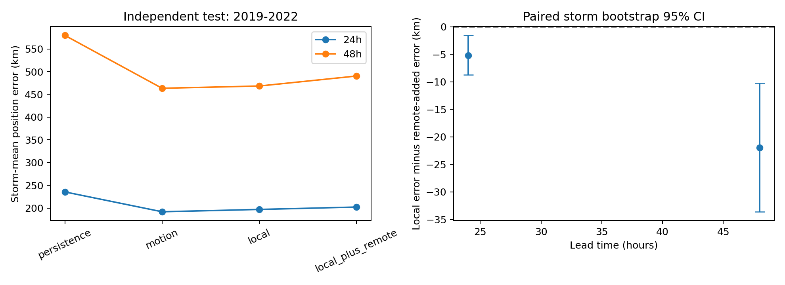

# 选题 C：远程 HE 涡度对气旋移动是否有增量信息？

分析日期：2026-10-28。问题限定为：在位置、季节、强度、近期运动，以及现有 NA 涡度和标量风速变量之外，加入 HE 远程涡度的低维表示，能否改善未来 24/48h 位置预测？主实验计划在运行前保存，未进行外部预注册。

## 核心结论

当前方案没有验证出正向增量，且添加远程特征后误差增大。验证集上扩展模型已经更差，因此若按验证结果选择是否增加信息，不应采用它。该结论仅适用于本数据、特征表示、参数搜索范围和线性模型，不能推导为“远程环流不影响气旋”。

## 数据与样本

原始版本 9acb13732ebc42b2468062b61156c2f26ee2da56。使用 HE 日均涡度、NA 日均涡度和风速、NA 三小时涡度、IBTrACS NA 主路径。文件时间暂按 UTC 对齐，变量单位和生产过程仍需来源说明。

发报时要求位于 5—45°N、250—350°E 且是 TD/TS/HU，过去至少 12h 及目标时刻有位置记录。预测目标允许风暴随后离开研究区或转变性质。每 6h 发报。由于 24/48h 位置资料可用性不同，两种提前量样本不完全相同；同一提前量所有模型使用完全相同的测试报次。

| 提前量 | 划分 | 风暴 | 报次 |
|---|---|---|---|
| 24 | train | 250 | 4674 |
| 24 | validation | 47 | 1089 |
| 24 | test | 79 | 1366 |
| 48 | train | 225 | 4050 |
| 48 | validation | 43 | 979 |
| 48 | test | 68 | 1165 |

训练2000—2015，验证2016—2018，测试2019—2022；跨划分风暴被剔除。最佳路径是事后分析资料，因此这是回顾性分析场实验，不能直接当作业务实时成绩。

## 局地控制与远程信息

运动基线包括位置及二次项、季节正余弦、当前 USA_WIND、过去 6/12h 移动和变化；持续运动使用最近 12h 位移。模型学习相对于持续运动的东/北向残差，最后还原为球面经纬度，使用大圆距离评价。

局地模型再加入：NA 当前及 6/12/24h 历史的 3×3 涡度块统计、NA 前完整日 1/3/5/7天的区域日均涡度 8个 PC、前一完整日的当地标量风速。没有多层 u/v、位势高度、海温或湿度，因此不声称已经控制完整的局地气象环境。标量风速不能代替引导风。

HE 288 个节点先排除扩展 NA 框（纬度 -2.5—52.5°、经度 242.5—357.5°）中的节点，留下 176 个节点。每次发报再将距当前中心不足1500km的节点异常置为零，即训练气候均值。此屏蔽基于当时已知位置。

HE 和 NA 日场均减去仅由训练年份拟合的31天平滑日历气候态，按训练异常标准差缩放。所有 PCA 仅拟合训练年份。HE 取前完整日 1/3/5/7天的4或8个 PC，并保留整日缺失标志和可用节点比例；没有使用发报之后的日平均。NA 获得相同的7天历史长度，避免仅靠增加历史窗口制造增量。

各模型使用按风暴等权的岭回归；alpha∈[1,10,100,1000]，HE PC数∈[4,8]。仅按验证集风暴等权平均距离选择参数。实际最优 alpha 均在该搜索范围上界，故不能把参数范围外或其他模型的可能表现视作已排除。

## 独立测试结果

以下主指标先对每个风暴的报次平均，再对风暴等权平均；不是把所有报次当作独立样本。

| 提前量 | 测试风暴/报次 | 持续运动误差 km | 仅运动/气候误差 km | 加局地场 km | 再加远程 HE km |
|---|---|---|---|---|---|
| 24 | 79/1366 | 235.46 | 191.79 | 196.91 | 202.15 |
| 48 | 68/1165 | 579.79 | 463.48 | 468.46 | 490.43 |

| 提前量 | 局地误差−远程扩展误差 km | 相对改善 | 按风暴 bootstrap 95% 区间 | 远程年度置换单侧 p |
|---|---|---|---|---|
| 24 | -5.24 | -2.66% | [-8.74, -1.58] | 0.980 |
| 48 | -21.97 | -4.69% | [-33.59, -10.21] | 1.000 |

改善定义为“局地模型误差减去加入远程信息后的误差”，负数表示变差。24h 配对风暴 bootstrap 区间为负，48h 也为负。单纯位置/近期运动/季节模型甚至优于现有局地涡度扩展，说明不能因为新增数据就默认有可用收益。

四个测试年份逐年描述统计也均未出现正向远程增量，详见 descriptive_year_breakdown.csv。此逐年检查是主结果后的描述性补充，不用于重新选择模型。

## 负对照

对 HE 异常按完整日历年、在各训练/验证/测试分区内部独立置换，保持同月同日及年内天气演变，打乱同年同步关系。每次都重新在验证集选择 PC数和 alpha；每个提前量50次，共100次。模型本体、局地输入和测试标签不变。负对照会人为使用其他测试年份的场，严格只作为离线零假设实验，不是可实时运行的预测方法。

单侧 p 检验的是“真实远程关系的改善是否高于置换远程关系”，数值约0.98和1.00，未支持改善。只有四个测试年，bootstrap也仅按风暴聚类，不能把此统计当作完整的气候因果检验。

## 代码、解释边界与后续

run.py 包含球面目标、训练期气候态/PCA、局地控制、远程掩膜、验证选择、整年负对照和按风暴 bootstrap。preprocessing.npz 保存本次 PCA 参数；validation_search.csv 保留全部验证搜索；test_predictions.csv 保留所有测试预测，便于复核。

这里的“大尺度联系”通过远程场的滞后低维表示检验，没有把相关网络边当作因果传播，也没有识别出可信的遥相关机制。低维 PCA 最大化的是方差，可能忽略对气旋有用的弱信号；线性模型、仅176个远程粗格点及有限年数都限制结论。

下一步优先补充多层引导风和位势高度，建立更强的物理基线；在训练/验证期比较按物理区域划分、正则化监督降维或其他有明确约束的模型，再使用新的未看过年份测试。当前2019—2022成绩已查看，不应反复调整后仍声称它是全新的独立测试。任何新尝试必须与这次主实验分开报告。
