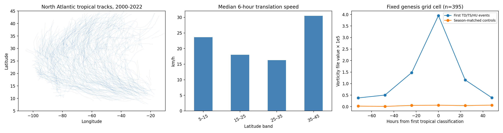

# 北大西洋小时/三小时涡度研究

本分支保存 `NA_5N45N_250E350E_Hourly/` 数据及其研究结果。共同验证资料仅附 IBTrACS 北大西洋路径文件 `data_hurricanes/ibtracs.NA.list.v04r01.csv`，用于路径和强度标签，不是另一套气象网格产品。数据版本：9acb13732ebc42b2468062b61156c2f26ee2da56。

主分析使用 2000—2022 年三小时涡度，并用 2020 年小时数据核对抽样一致性。三小时矩阵 67208×160，无非有限值；2020 年小时矩阵 8784×160，同时间三小时抽样完全一致。其余全部小时文件的逐点一致性未逐一验证。文件时间暂按 UTC 对齐，单位与来源仍需进一步确认。涡度数值按原单位或原值×10⁵展示。

这是回顾性探索，不是已验证的预报模型。5°块平均适合大尺度研究，不适合精确解析飓风核心。



## 2. 移动规律

从路径取标准 00/06/12/18 时位置，只统计相邻恰好 6 小时、段起点位于研究区且状态为 TD/TS/HU 的位移。速度为球面距离除以 6 小时，是**中心平移速度，不是最大风速**。共有 397 个风暴、8113 段。

| 纬度带（°N） | 6小时段数 | 风暴数¹ | 平移速度中位数 km/h | 向西比例 | 向北比例 |
|---|---|---|---|---|---|
| 5–15 | 1260 | 145 | 23.6 | 96.0% | 81.1% |
| 15–25 | 3024 | 242 | 18.0 | 85.5% | 84.8% |
| 25–35 | 2893 | 256 | 16.3 | 47.2% | 79.9% |
| 35–45 | 936 | 161 | 30.5 | 7.8% | 85.4% |

¹同一风暴可以跨越多个纬度带，因此各带风暴数不能相加。比例按时间段加权，持续时间较长的风暴贡献较多；向北/西的零位移分别不计入正向比例。

低纬明显偏西，25—35°N 东西向混合，35—45°N 明显偏东，且高纬平移速度更快。这与信风区西行、进入中纬度后转向及受西风引导的物理图景一致，但表格本身不能证明机制，也不表示每条路径一定转向。转向是同一风暴内部的变化，仍需逐风暴识别持续转向时刻，控制季节、强度与经度后检验，避免把不同样本构成误认为单一轨迹演变。

已进行 1000 次按风暴整组重采样的 bootstrap，速度和方向比例区间见 `movement_cluster_ci.csv`；不把相邻六小时段当作独立风暴。

**涡度能否跟踪移动？** 在每个已知中心 800 km 范围内取最大正涡度格点，比较相隔 24 小时的格点位移：369 个风暴、6428 段；格点中心相对路径中心的误差中位数为 214 km，23.2% 的 24 小时段中最大值仍停留同一格点。东西/南北位移相关系数分别为 0.87/0.67。

这是**两端都用真实路径限定搜索范围的回顾诊断**，不是独立涡旋追踪，更不是路径预报精度；相关系数不能作为模型成绩。它仅支持用该产品描述大尺度传播方向，同时显示空间量化误差。独立追踪需仅从前一时刻位置推进、进行多候选匹配，再与未参与搜索的路径验证。

## 3. 形成前后涡度

研究区内共有 396 个首次热带分类候选，其中 395 个具备完整的 -72 至 +48 小时窗口与至少两个对照。每个事件固定在首次分类位置的最近网格，不随风暴移动。对照取同年同地点、同一时刻、前后 14/21/28 天的候选日期；如候选日期前后 24 小时有任一记录中心位于 1112 km 内则排除。每个事件先平均其可用对照，再对所有事件等权平均。差值区间由按事件重采样 2000 次得到；属探索性点态区间，未作多重比较调整。

以下均为文件涡度数值 ×10⁵：

| 相对时刻（小时） | 事件均值 | 对照均值 | 差值 | 差值95%区间 |
|---|---|---|---|---|
| -72 | 0.378 | 0.023 | 0.354 | [0.206, 0.512] |
| -48 | 0.502 | 0.011 | 0.491 | [0.327, 0.655] |
| -24 | 1.477 | 0.053 | 1.424 | [1.220, 1.633] |
| 0 | 3.951 | 0.062 | 3.889 | [3.688, 4.095] |
| 24 | 1.159 | 0.046 | 1.113 | [0.852, 1.382] |
| 48 | 0.386 | 0.065 | 0.320 | [0.110, 0.538] |

首次分类前 24—72 小时，未来形成位置的低层正涡度相对季节邻近对照偏强，接近首次分类时增强更明显。剔除记录开始即为热带气旋的事件后，剩余 165 个有先前非热带记录的事件，-24 小时的差值仍为 2.042（同样缩放），方向一致。详见 `genesis_sensitivity.csv`。

**解释边界：**

- 230 个匹配事件在记录开始时已属热带气旋，实际物理形成可能更早；即使有前期非热带记录，分类时刻也不是精确的动力学起点。
- 使用了“后来在哪里形成”这一未来信息，所以该图不能宣称提前 72 小时可预测形成。前期信号也可能来自正在向该地点移动的已有扰动。
- 对照是没有近邻已记录中心的日子，并非经过追踪确认“最终未形成的同类扰动”。因此不能估算形成概率、漏报率或虚警率。
- 固定地点在 +24/+48 小时的涡度下降可能主要是风暴离开该格点，不能解释为风暴减弱。须增加随中心移动的合成作区分。
- 未校正天气背景、海陆差异及空间环境条件，也未验证强度增长、首次 HU 或快速增强；这些是不同任务。

## 4. 还需要哪些数据？

| 数据 | 移动研究的作用 | 形成研究的作用 | 优先级 |
|---|---|---|---|
| 多层 u、v 风：850/700/500/300/200 hPa，条件允许增加中间层 | 深层平均引导气流、环境环流与转向，强弱风暴可用不同层厚 | 850—200 hPa 矢量风切变、低层辐合与组织化 | 首要 |
| SST，海陆掩膜 | 陆地接近与海洋环境分层 | 判断暖海洋条件；海温高本身并不充分，也不采用固定阈值作为万能规则 | 首要 |
| 600/700 hPa 相对湿度或比湿及温度 | 区分干空气环境 | 中层干空气、对流维持与湿化过程 | 首要 |
| 海平面气压、位势高度，多层温湿廓线 | 副热带高压/槽脊与闭合低压 | 闭合环流、热力稳定度与潜在强度 | 高 |
| 高频降水或 OLR/红外云图 | 检查对流与涡旋是否一致移动 | 持续深对流和对流组织化 | 高 |
| 海洋上层热含量/混合层深度、海洋温度廓线 | 对强度变化的影响 | 尤其用于首次达到 HU、快速增强及海洋反馈 | 后续 |

现有 WindSpeed850 只有风速大小，不能代替 u、v 求引导风或矢量风切变；`VV850` 在未确认定义前不作为垂直速度使用。相对涡度和绝对涡度要分清；若确认为相对涡度，可用节点纬度加上科氏参数构造绝对涡度，但须正确处理南北半球符号。

可优先从 ERA5 获取同一时期的上述环境场，尽可能保留 0.25—1°而非进一步压缩成 5°块；IBTrACS 继续作为路径/强度标签。其他海盆需分别处理相反涡度符号、经度边界及季节，不把本次 NA 数值外推全球。本次没有下载额外环境资料。

## 5. 可执行的后续研究设计

1. **移动：** 先做无需真实未来中心的涡旋候选提取与连续追踪，限定速度/连续性并允许消失和合并；用 IBTrACS 独立检验定位误差、轨迹保持率和误匹配。结合环境引导风解释转向。24/48/72 小时路径预报先比较持续运动基线，再增加环境风与涡度特征。
2. **形成：** 从完整时空场追踪所有初始扰动，标记未来 24/48/72 小时是否首次达到 TD/TS；首次 HU 则另建任务。建立与形成扰动同季节、同地区、相近初始涡度的未形成扰动对照。特征只使用截止时刻及此前资料，不能以未来形成地点选择候选。
3. **验证：** 预先固定 2000—2015 训练、2016—2018 验证、2019—2022 留出测试，并使同一风暴/扰动及其时间窗口只属于一个划分。按风暴/扰动聚类评估；不要随机拆相邻小时。比较气候基线、仅涡度、涡度加环境数据的增量收益。形成任务报告 PR-AUC、召回/虚警、Brier 分数与校准；路径任务报告球面距离误差并分提前量比较。该预测实验尚未执行。
4. **日/小时分工：** 日度用于季节与大尺度背景；三小时用于移动、形成前合成和扰动追踪；小时用于检验短时演变是否增加信息。日最大/最小是时段统计量，不能当作某个瞬时的涡度图。实时预测不能使用截止时刻之后才完整的当日日均/极值。


## 本分支独立复现

原始小时数据和唯一使用的 NA 路径文件均在本分支中，运行不需要其他两个网格数据分支。先确保 Git LFS 完整检出，再在仓库根目录运行：

```bash
git lfs pull
python3 results/analyze.py
python3 results/diagnostics.py
```

依赖 Python 3.12、NumPy 2.3.5、pandas 2.2.3、Matplotlib 3.10.8。输出和缓存位于 results/，原始数据不变。更换原始数据版本时清除旧 `.npy` 缓存再运行。

本报告的日度/小时研究分工和补充数据表是后续研究建议；本分支不声称已经用其他网格数据完成独立研究。历史跨产品总报告仍保留在 results 分支。
